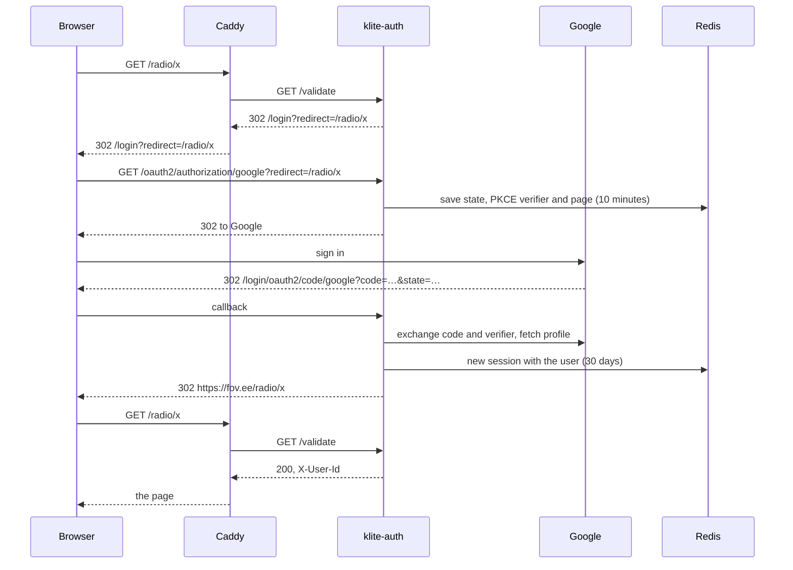

# klite-auth

[](https://github.com/ktenman/klite-auth/actions/workflows/ci.yml)

## Overview

This authentication service is a [Klite](https://github.com/keksworks/klite) application written in Kotlin that provides
OAuth2 authentication using Google as the identity provider. It protects the fov.ee sites: Caddy's `forward_auth` asks
`/validate` before every request, and only Google accounts listed in `ALLOWED_EMAILS` get through. It is a port of the
Spring Boot [auth](https://github.com/ktenman/auth) service with the same endpoints, in half the memory.



## Features

- OAuth2 authentication with Google, using `state` and PKCE (S256)
- Session management using Redis
- Configurable allowed email addresses, checked at sign-in and on every validation
- Return to the page the user came from after signing in
- Secure logout mechanism
- Session validation endpoint for Caddy's `forward_auth`

## Technologies Used

- Kotlin 2.4
- Klite 2.1 on the JDK's built-in HTTP server
- Redis for session storage, through Jedis
- GraalVM native image (about 11 MiB of memory in use)
- Docker for containerization

## Prerequisites

- JDK 25
- Docker and Docker Compose
- Redis
- Google OAuth2 credentials (Client ID and Client Secret)

## Configuration

The application uses environment variables for configuration. Make sure to set the following variables:

- `GOOGLE_CLIENT_ID`: Your Google OAuth2 client ID
- `GOOGLE_CLIENT_SECRET`: Your Google OAuth2 client secret; the client's redirect URI is `<REDIRECT_URI>/login/oauth2/code/google`
- `REDIRECT_URI`: The URI to redirect after successful authentication, e.g. `https://fov.ee`
- `ALLOWED_EMAILS`: Comma-separated list of email addresses allowed to authenticate

Optional:

- `REDIS_URL`: Redis to keep sessions in, `redis://redis:6379` by default. Anything that can write to this Redis can
  create sessions, so keep it on a network only this service reaches, or give it a password (`redis://:password@redis:6379`)
- `PORT`: Port to listen on, 8083 in the Docker image
- `GOOGLE_AUTHORIZATION_URI`, `GOOGLE_TOKEN_URI`, `GOOGLE_USER_INFO_URI`: Google's endpoints by default; the tests and
  `bench/run.sh` point them at a stand-in for Google

## Running the Application

1. Start Redis on `localhost:6380` from `compose.yaml`:
   ```bash
   docker compose up -d
   ```
2. Set up the environment variables mentioned above and run the application using Gradle:
   ```bash
   PORT=8083 REDIS_URL=redis://localhost:6380 ./gradlew run
   ```

The application will start on port 8083.

## API Endpoints

* `/validate`: `200` with `X-User-Id: <email>` for an allowed user, `302` to `/login?redirect=<X-Forwarded-Uri>` when
  signed out, and `401` once the email is no longer allowed
* `/login`: Login page
* `/oauth2/authorization/google`: Initiates Google OAuth2 authentication
* `/login/oauth2/code/google`: Google's callback; returns the user to the page they came from
* `/user`: Returns authenticated user information
* `POST /logout`: Logs out the current user; refused with `403` when sent from another site
* `/` and `/home`: Page for allowed signed-in users
* `/actuator/health`: Health check, which also pings Redis

## Security Considerations

- Only configured email addresses that Google has verified are allowed to authenticate, and removing one locks that
  user out at once
- Sessions use random 256-bit IDs, of which Redis keeps only a hash, and signing in always issues a new one
- A session lasts 30 days from signing in with Google; nothing else extends it
- A sign-in attempt expires after 10 minutes and only accepts Google's answer with a matching `state` and PKCE verifier
- After signing in, users return only to paths on the same site
- The session cookie `__Host-AUTHSESSION` is `HttpOnly`, `Secure` and `SameSite=Lax`
- Request logs leave out OAuth codes and redirect targets, and escape control characters

## Development

To set up the development environment:

1. Clone the repository
2. Import the project into your IDE as a Gradle project
3. Start Redis with `docker compose up -d` and set the environment variables
4. Run `Main.kt` to start the application

```
src/main/kotlin
├── Main.kt                 wiring and configuration
├── domain/                 ReturnPath, SignInAttempt, User, randomToken; JDK only
├── usecase/                StartSignIn, FinishSignIn and the GoogleAccounts port
└── adapter/
    ├── web/                routes, HTML pages, error page
    ├── session/            session contents and lifetime, Redis store
    └── google/             OAuth client with PKCE
```

Dependencies point inward: adapters use the use cases, and the use cases use the domain. The domain and use cases import
nothing from Klite, Redis or HTTP.

Dependabot opens monthly updates for Gradle and GitHub Actions; pull requests only run the tests, and minor and patch updates merge themselves once they pass.

## Testing

Run the tests, with Redis from `docker compose up -d`, using:
```bash
./gradlew test
```

The tests start the service in-process against a stand-in for Google that enforces PKCE, and cover sign-in, sign-out,
the allowlist, return paths, session lifetimes and Redis being down.

`bench/run.sh` signs in against a stand-in for Google, checks the session, page and logout paths, sends 27,000 requests,
then prints the container's memory use. On `main`, CI runs it against each native image before pushing it.

## Docker

The application includes a Dockerfile that builds a GraalVM native image. To build and run the Docker image:

1. Build the Docker image (compiling the native image takes about a minute and about 2.5 GB of memory):
   ```bash
   docker build -t klite-auth .
   ```
   `src/main/resources/META-INF/native-image/ee.tenman/klite-auth/reachability-metadata.json` lists what Klite reaches
   by reflection, such as the classes its JSON mapper builds. It was recorded by running the tests under GraalVM's
   tracing agent. After adding such a class, record it again or add the type, or the native image fails on that path
   while the JVM tests still pass.

2. Run the Docker container:
   ```bash
   docker run -p 8083:8083 -e GOOGLE_CLIENT_ID=your_client_id -e GOOGLE_CLIENT_SECRET=your_client_secret -e REDIRECT_URI=your_redirect_uri -e ALLOWED_EMAILS=allowed@email.com klite-auth
   ```
   The container expects Redis at the host name `redis`; set `REDIS_URL` to use another one.

CI pushes the image to GitHub Container Registry as `ghcr.io/ktenman/klite-auth:latest` from `main`.

## Compared with the Spring version

`IMAGE=ktenman/auth:latest bench/run.sh` measures the Spring version the same way, on 2 CPUs.

| | klite-auth (native image) | auth (Spring, native image) |
|---|---|---|
| Startup | 0.3 s | 0.8–0.9 s |
| 27,000 requests | 2.0–2.1 s | 9.3–11.5 s |
| Memory after load (anon) | 11 MiB | 23 MiB |
| Image | 49 MB | 73 MB |
| Kotlin, main / test | 277 / 266 lines | 299 / 185 lines |

Five runs each, on an Apple Silicon Mac, 2026-11-15.
