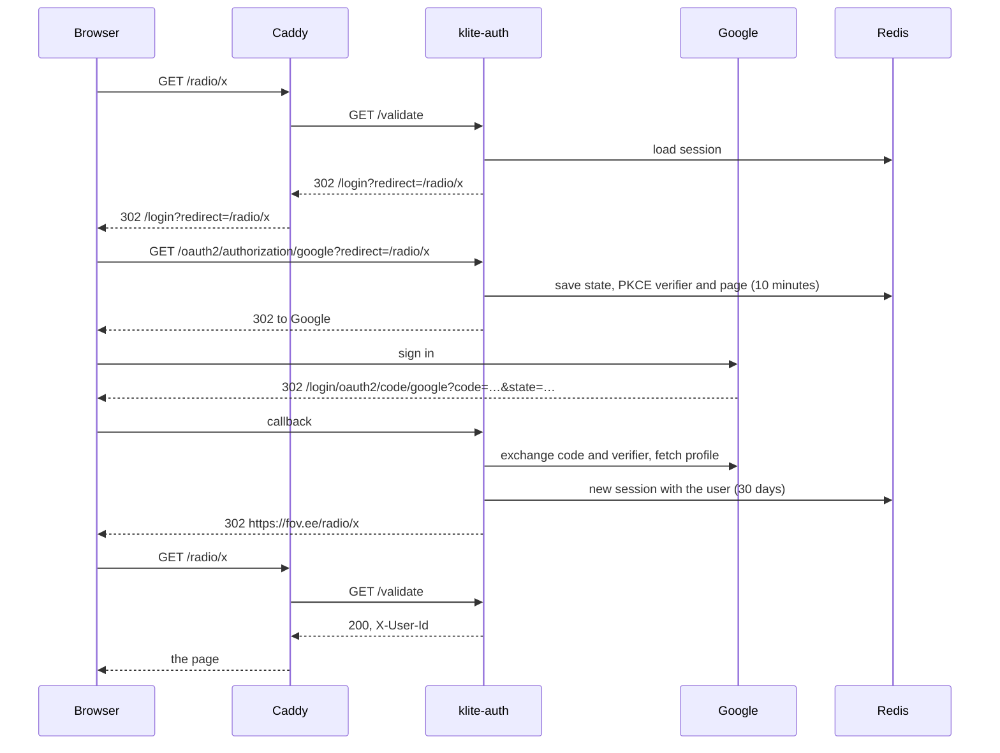

# klite-auth

Google sign-in for the fov.ee sites, written with [Klite](https://github.com/keksworks/klite) and shipped as a GraalVM native
image. Caddy's `forward_auth` asks `/validate` before every request to a protected site, and only Google accounts listed in
`ALLOWED_EMAILS` get through. It is a port of the Spring Boot [auth](https://github.com/ktenman/auth) service with the same
endpoints, in half the memory.

## How it works



- **Sessions** live in Redis under `auth:session:<id>`, behind an `AUTHSESSION` cookie (`HttpOnly`, `Secure`, `SameSite=None`).
  A sign-in in progress lasts 10 minutes, a signed-in session 30 days, and signing in always issues a new session ID.
- **Sign-in** uses the authorization code flow with `state` and PKCE (S256). A callback whose `state` doesn't match the
  attempt in the session is ignored, and the attempt stays usable.
- **Return paths** must start with a single `/`, be at most 2048 characters and parse as a URI. Anything else lands on
  `REDIRECT_URI`.
- **The allowlist** is checked when signing in and again on every `/validate`, so removing an email locks that user out
  at once.

## Endpoints

| Endpoint | Result |
|---|---|
| `GET /validate` | `200` with `X-User-Id: <email>` for an allowed user; `302` to `/login?redirect=<X-Forwarded-Uri>` when signed out; `401` when the email is no longer allowed |
| `GET /login` | Sign-in page; keeps `?redirect=` for after sign-in |
| `GET /oauth2/authorization/google` | Starts a sign-in and redirects to Google |
| `GET /login/oauth2/code/google` | Google's callback; `302` to the page the user came from, `/login?error` if Google fails, `401` for an email not on the list |
| `POST /logout` | Ends the session and redirects to `/` |
| `GET /user` | `{"status":"AUTHORIZED","provider":"google","user":{…}}` with the profile, or `{"status":"UNAUTHORIZED",…}` once the email is off the list |
| `GET /`, `GET /home` | Page for signed-in users |
| `GET /actuator/health` | `{"status":"UP"}` when Redis answers |

## Configuration

| Variable | |
|---|---|
| `GOOGLE_CLIENT_ID`, `GOOGLE_CLIENT_SECRET` | OAuth client from the Google Console; its redirect URI is `<REDIRECT_URI>/login/oauth2/code/google` |
| `REDIRECT_URI` | Where users land after signing in, e.g. `https://fov.ee` |
| `ALLOWED_EMAILS` | Comma-separated Google accounts that may sign in |
| `REDIS_URL` | Default `redis://redis:6379` |
| `PORT` | 8083 in the Docker image |
| `GOOGLE_AUTHORIZATION_URI`, `GOOGLE_TOKEN_URI`, `GOOGLE_USER_INFO_URI` | Google's endpoints by default; the tests and the bench point them at a fake Google |

## Running

```bash
docker run -p 8083:8083 \
  -e GOOGLE_CLIENT_ID=… -e GOOGLE_CLIENT_SECRET=… \
  -e REDIRECT_URI=https://fov.ee -e ALLOWED_EMAILS=you@example.com \
  -e REDIS_URL=redis://redis:6379 \
  ktenman/klite-auth
```

CI builds the image on amd64 and arm64, runs `bench/run.sh` against each, and pushes `ktenman/klite-auth:latest` to Docker
Hub from `main`. To build it yourself, run `docker build -t klite-auth .`; the native build takes about a minute and needs
about 2.5 GB of memory for Docker.

In Caddy, protect a site with `forward_auth` and send the sign-in paths to the service:

```caddyfile
@auth path /login /login/* /oauth2/* /logout
handle @auth {
    reverse_proxy auth:8083
}
handle {
    forward_auth auth:8083 {
        uri /validate
        copy_headers X-User-Id
    }
    reverse_proxy app:8080
}
```

## Development

Needs JDK 25 and Docker.

```bash
docker compose up -d   # Redis on localhost:6380
./gradlew test
```

The tests start the service in-process against a fake Google that enforces PKCE, and cover sign-in, sign-out, the
allowlist, return paths, session lifetimes and Redis being down.

Dependabot opens monthly updates for Gradle and GitHub Actions; minor and patch updates merge themselves once CI passes.

```
src/main/kotlin
├── Main.kt                 wiring and configuration
├── domain/                 ReturnPath, SignInAttempt, User, randomToken; JDK only
├── usecase/                StartSignIn, FinishSignIn and the GoogleAccounts port
└── adapter/
    ├── web/                routes, HTML pages, error page
    ├── session/            session contents and lifetime, Redis store
    └── google/             OAuth client with PKCE
```

Dependencies point inward: adapters use the use cases, and the use cases use the domain. The domain and use cases import
nothing from Klite, Redis or HTTP.

## Native image

The Docker image is a GraalVM native image. A native image only keeps the classes and resources the build can see being
used, so `src/main/resources/META-INF/native-image/ee.tenman/klite-auth/reachability-metadata.json` lists what Klite
reaches by reflection, such as the classes its JSON mapper builds. It was recorded by running the tests under GraalVM's
tracing agent, keeping only the app's entries (not Gradle's, JUnit's or the test classes').

Record it again after adding a class that Klite builds by reflection, such as a new JSON body. Otherwise the native image
fails on that path while the JVM tests still pass. CI runs `bench/run.sh` against the built image, which catches most of these.

## Compared with the Spring version

`bench/run.sh` builds the image and runs it on 2 CPUs next to Redis and a fake Google. It checks that sign-in, validate and
sign-out still work, sends 27,000 requests (mostly `/validate`, as Caddy's `forward_auth` does), then reads the container's
memory. `IMAGE=ktenman/auth:latest bench/run.sh` measures the Spring version the same way.

| | klite-auth (native image) | auth (Spring, native image) |
|---|---|---|
| Startup | 0.3 s | 0.8–0.9 s |
| 27,000 requests | 2.0–2.1 s | 9.3–11.5 s |
| Memory after load (anon) | 11 MiB | 23 MiB |
| Image | 49 MB | 73 MB |
| Kotlin, main / test | 277 / 266 lines | 299 / 185 lines |

Five runs each, on an Apple Silicon Mac, 2026-11-15.
